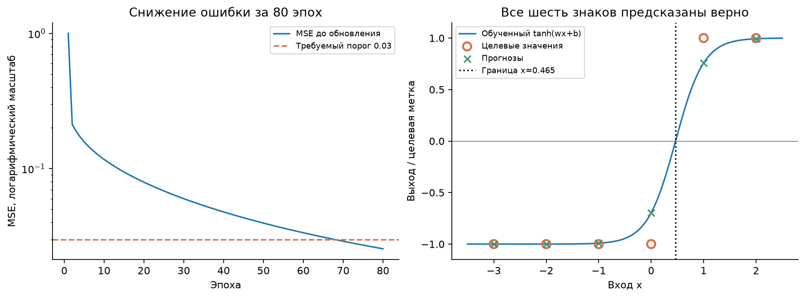

# ЛР №4: собственное автоматическое дифференцирование

## Что сдавать

Сдаётся **`ЛР_4_Скалярное_автоматическое_дифференцирование.ipynb`**.
Все данные заданы внутри: отдельный CSV или JSON не нужен.
Также подготовлен `ЛР_4_готовая_работа.zip` с ноутбуком, HTML,
этим пояснением и экспортом результатов.

В ноутбуке заполнены все 13 обязательных кодовых ячеек шаблона, сохранены
их выводы, добавлены математические пояснения и ответы на восемь вопросов.
Отдельная дополнительная ячейка показывает правило произведения и повторный
обратный проход. Алгоритм и параметры основной работы соответствуют методичке.

Исходные PDF остаются в папке ЛР_4 и не нужны для запуска вычислений.
Вычислительная часть использует только стандартную библиотеку Python — `math`.

## В чём заключалось задание

Нужно было написать маленькую систему, которая сама вычисляет производные
скалярных выражений, а затем с её помощью обучить один нейрон.
Вместо готового `backward` из PyTorch здесь реализуется собственный.

Работа состоит из двух частей:

1. Класс `Value` строит вычислительный граф и распространяет градиенты назад.
2. Класс `TanhNeuron` использует `Value` для веса и смещения и обучается
   градиентным спуском на шести примерах.

Требовалось проверить арифметические операции, элементарные функции,
накопление градиентов, ручную трассировку, конечные разности и обучение.
Для обучения заданы 80 эпох, шаг 0,2 и нулевые начальные параметры.
Критерии результата: ошибка меньше 0,03 и точность 1 на учебных объектах.

## Как устроен Value

Обычное число хранит только значение. `Value` дополнительно хранит информацию,
позволяющую выяснить, как это значение было получено:

| Поле | Смысл |
|---|---|
| `data` | Число, полученное на прямом проходе |
| `grad` | Производная итогового результата по этой вершине |
| `parents` | Ссылки на непосредственные входы операции |
| `op` | Метка операции, например `+` или `tanh` |
| `_backward` | Локальное правило передачи градиента родителям |

Когда выполняется `a*b`, создаётся новый `Value` с результатом произведения
и ссылками на `a` и `b`. Одновременно сохраняется небольшая функция:
для производной по `a` она использует значение `b`, для производной по `b` — `a`.
Эта функция ещё не вычисляет градиент: она будет вызвана на обратном проходе.

Так постепенно строится ориентированный ациклический граф.
Операции сложения, умножения, отрицания, вычитания, степени,
синуса, экспоненты, логарифма и tanh имеют свои локальные производные.
Их объединяет правило цепочки.

## Почему нужен оператор +=

Одна переменная может влиять на результат несколькими путями.
Например, для `f = a*a+a`:

```text
f(a) = a² + a
f'(a) = 2a + 1
f'(2) = 5
```

Две ссылки в умножении дают два вклада по 2, а последнее сложение — ещё 1.
Если каждый новый вклад записывать через `=`, предыдущий будет потерян.
Поэтому используется накопление `+=`.

Множество `visited` здесь решает другую задачу: одна вершина должна попасть
в список обхода один раз. Оно не удаляет повторные рёбра и не отменяет
оба вклада от умножения `a*a`.

## Как проходит backward

Сначала рекурсивный обход добавляет родителей раньше потомков.
Потом градиенты достижимых вершин обнуляются, а градиент итоговой вершины
устанавливается в 1: производная результата по самому себе равна 1.

Локальные правила вызываются в обратном топологическом порядке.
Поэтому к моменту обработки узла его потомки уже передали все свои вклады.
Узел умножает накопленный градиент на свою локальную производную
и прибавляет результат родителям.

Для `J=tanh(a*b+a)` при `a=0,5`, `b=1` ручная трассировка дала:

- после tanh градиент внутренней суммы — **0,419974342**;
- после сложения первый вклад в `a.grad` — **0,419974342**;
- после умножения итоговый `a.grad` — **0,839948683**, `b.grad` — **0,209987171**.

## Как проверено дифференцирование

Контрольная функция:

```text
f(x) = sin(x)·exp(x) + x³
f'(x) = exp(x)·cos(x) + sin(x)·exp(x) + 3x²
```

При `x=0,37` получены:

| Способ | Производная |
|---|---:|
| Собственный Value | 2,2839857484831385 |
| Центральная разность с шагом 10⁻⁶ | 2,283985748363637 |
| Абсолютная разница | около 1,20×10⁻¹⁰ |

Разница существенно меньше заданного допуска 10⁻⁵.
Конечные разности служат независимой проверкой; сами градиенты при обучении
вычисляются по графу, без численного возмущения каждого параметра.

Дополнительный разбор `sin(x)*exp(x)` показывает оба слагаемых правила
произведения: **0,5235231781 + 1,3497625704 = 1,8732857485**.
Если последнее слагаемое присвоить вместо прибавления, первое потеряется.
Повторный `backward` на неизменённом графе не удваивает результат,
потому что метод сначала сбрасывает старые градиенты.

## Как обучался нейрон

Модель имеет вид `prediction = tanh(weight*x + bias)`.
Входы: `[-3, -2, -1, 0, 1, 2]`, цели: `[-1, -1, -1, -1, 1, 1]`.
Функция потерь — среднее квадратов разностей между прогнозами и целями.

При нулевых весе и смещении все прогнозы равны нулю, поэтому MSE равна 1.
Начальный градиент по весу равен **-3**, по смещению — **2/3**.
Обновление с минусом увеличивает вес и уменьшает смещение.

Каждая эпоха строит новый граф ошибки, вызывает `backward`, затем меняет
числовые значения параметров. Вес и смещение остаются теми же объектами
`Value`, общими для всех шести примеров. Поэтому их градиенты собирают
вклады всего набора данных.

Обновлять параметры раньше обратного прохода нельзя: локальные замыкания
прочитают новые значения вместо значений того прямого прохода,
для которого вычисляется градиент.

## Итог обучения

| Показатель | Результат |
|---|---:|
| Начальная MSE | 1,000000 |
| Последняя MSE в истории, до обновления 80-й эпохи | 0,02555003 |
| MSE после всех 80 обновлений | 0,02524209 |
| Вес | 1,84951307 |
| Смещение | -0,85910992 |
| Граница смены знака прогноза | x ≈ 0,464506 |
| Точность на шести обучающих примерах | 6 из 6, то есть 100% |



Граница находится между 0 и 1, как и требуется для заданных меток.
Точность уже равна 100%, хотя MSE положительна: знаки верные, но значения
tanh ещё не совпадают с целями -1 и 1. Это результат на учебных данных,
а не измерение качества на независимой тестовой выборке.

## Короткий ответ для защиты

«Я реализовал скалярный класс Value, который хранит число, связи с родителями
и локальное правило производной. При прямом проходе строится граф,
а backward обходит его в обратном топологическом порядке и складывает
градиенты всех путей. Я проверил общий узел на a*a+a и получил производную 5.
Сравнение с центральной разностью дало ошибку около 1,2×10⁻¹⁰.
Затем я обучил один tanh-нейрон, используя собственные градиенты.
После 80 обновлений MSE стала примерно 0,02524, а знаки всех шести
прогнозов совпали с метками. Библиотеки машинного обучения для этого
не использовались».

## Как запустить

Открой `.ipynb` в Jupyter, VS Code или Google Colab, перезапусти ядро
и выполни все ячейки сверху вниз. Дополнительных данных и вычислительных
пакетов не требуется. Сам интерфейс открытия ноутбука должен быть установлен
или доступен в браузере.

Для просмотра без выполнения открой HTML. Все результаты уже сохранены
в ноутбуке. В `results` дополнительно находятся история ошибки, прогнозы,
сводка эксперимента и иллюстрация этого запуска.

Использованы приложенные `lab_guide.pdf`, `theory.pdf` и
`product_rule_debugging.pdf`. Их исходные файлы не изменялись.
