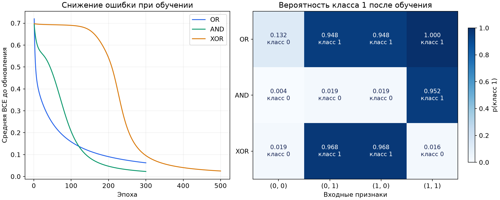

# Пояснение к ЛР № 5

## Задание

Продолжить четвёртую лабораторную: механизм автодифференцирования остаётся
скалярным, но теперь каждый объект имеет два признака: например, `[0, 1]`.
Модель сама составляет граф из обычных сложений, умножений и нелинейных функций.

Нужно было заполнить 14 кодовых ячеек выданного шаблона по методичке:

1. Перенести полный `Value` и проверить общий лист на выражении `a*a+a`: при `a=2`
   значение равно 6, производная равна 5.
2. Реализовать аффинную сумму, sigmoid, бинарную кросс-энтропию и среднюю потерю.
3. Обучить один sigmoid-нейрон для OR и получить BCE < 0,1.
4. Обучить модель с одним скрытым tanh-нейроном для AND и получить BCE < 0,05.
5. Обучить модель с двумя скрытыми tanh-нейронами для XOR и получить BCE < 0,03.
6. Для каждой архитектуры проверить все градиенты центральной разностью и получить
   точность 1,0 на четырёх объектах. Ответить на вопросы для самопроверки.

Данные одинаковы по форме: `(0,0)`, `(0,1)`, `(1,0)`, `(1,1)`.
Различаются правильные ответы:

| Вход | OR: хотя бы один равен 1 | AND: оба равны 1 | XOR: ровно один равен 1 |
|---|---:|---:|---:|
| (0, 0) | 0 | 0 | 0 |
| (0, 1) | 1 | 0 | 1 |
| (1, 0) | 1 | 0 | 1 |
| (1, 1) | 1 | 1 | 0 |

## Как работает модель

`affine` добавляет единицу к входу и считает
$z=w_0\cdot1+w_1x_1+w_2x_2$. Вес $w_0$ задаёт смещение и сдвигает границу классов.
Все три веса хранятся в объектах `Value`, общих для всей выборки.
Числовые признаки временно становятся константами графа, но не обучаются.

Sigmoid $p=1/(1+e^{-z})$ превращает логит в вероятность класса 1.
При $p\ge0.5$ выбирается класс 1, иначе класс 0.
Для одного объекта BCE вычисляется так:
$\ell=-y\ln p-(1-y)\ln(1-p)$.
Например, при правильном ответе 1 высокая вероятность даёт маленькую ошибку,
а при правильном ответе 0 маленькую ошибку даёт низкая вероятность.
Обучение минимизирует среднюю BCE по четырём объектам.

Одна эпоха: построить свежий граф → вычислить среднюю потерю → вызвать `backward()` →
обновить каждый параметр по правилу $w\leftarrow w-\eta\,\partial L/\partial w$.
Старые вычислительные узлы больше не используются, но объекты весов сохраняются.

OR решается одним нейроном и одной линейной границей. AND тоже линейно разделим,
но скрытый tanh здесь специально добавлен для проверки цепного правила.
В XOR положительные точки лежат по диагонали: одной прямой их отделить нельзя.
Два разных скрытых нейрона создают признаки, комбинация которых позволяет решить XOR.

Количество параметров: OR: 3; AND: 3 скрытых + 2 выходных = 5;
XOR: 2 × 3 скрытых + 3 выходных = 9. Смещения включены в эти числа.

## Результаты

| Задача | Архитектура | Параметры | Эпохи / шаг | Начальная BCE | Последняя BCE* | Точность |
|---|---|---:|---|---:|---:|---:|
| OR | 1 sigmoid | 3 | 300 / 0.5 | 0.720020 | 0.062364 | 100% |
| AND | 1 tanh → sigmoid | 5 | 300 / 0.3 | 0.693386 | 0.022928 | 100% |
| XOR | 2 tanh → sigmoid | 9 | 500 / 0.5 | 0.697490 | 0.025123 | 100% |

*В журнал записывается BCE до обновления весов в соответствующей эпохе, как в методичке.
При повторном прямом проходе после последнего обновления BCE равна
OR: 0,062167; AND: 0,022805; XOR: 0,025026. Прогнозы вычислены после последнего обновления.

Все исходные `assert` прошли. Максимальное расхождение автоградиента с центральной
разностью по всем 17 параметрам трёх моделей меньше $1.3\cdot10^{-10}$
при допуске $10^{-5}$. Нулевой начальный градиент первого реального входного веса AND
подтверждён численной проверкой: при заданной инициализации вклады объектов компенсируются.

Файлы `results/training_history.csv`, `predictions.csv`, `gradient_checks.csv` и
`experiment_summary.json` содержат историю потерь, прогнозы, сравнение градиентов и
сводку с полными числовыми значениями. Индексы параметров в таблице градиентов начинаются с 0:
для OR: список весов; для AND: скрытые, затем выходные;
для XOR: первая скрытая строка, вторая скрытая строка, затем выходные веса.

## Ответы на вопросы для самопроверки

1. Какие скалярные вершины создаёт `affine` для двух признаков?

Входные обучаемые листья: $w_0,w_1,w_2$. Числа $1,x_1,x_2$ оборачиваются в константные листья.
Три узла умножения вычисляют $w_0\cdot1$, $w_1x_1$, $w_2x_2$; два узла сложения
собирают $z=(w_0\cdot1+w_1x_1)+w_2x_2$. В `parameters()` входят только веса, констант там нет.
Значение признака задаётся данными, поэтому градиентный спуск его не изменяет.

2. Почему одна ссылка на `weights[0]` даёт сумму вкладов всех объектов?

Вызовы модели используют один и тот же объект `Value` смещения, а не его копии.
Потери объектов объединены в один граф средней BCE. При обратном проходе все пути
приходят к общему листу; `+=` накапливает вклады:
$\partial L/\partial w_0=\frac1n\sum_i(p_i-y_i)$.
Сброс градиентов выполняется один раз перед обходом, а не перед каждым вкладом.

3. Где хранится вероятность класса 1?

В выходном узле `sigmoid`, его `data` лежит между 0 и 1. Скрытый `tanh` возвращает
признак в интервале $(-1,1)$ и не является вероятностью. Класс равен 1 при $p\ge0.5$.

4. Почему BCE вместе с sigmoid даёт градиент логита $p-y$?

Для одного объекта $\ell=-y\ln p-(1-y)\ln(1-p)$ и $p=\sigma(z)$.
По правилу цепочки:
$$\frac{\partial\ell}{\partial z}
=\left(-\frac yp+\frac{1-y}{1-p}\right)p(1-p)=p-y.$$
Для средней потери вклад объекта равен $(p_i-y_i)/n$;
$\partial L/\partial w_j=\frac1n\sum_i(p_i-y_i)\tilde x_{ij}$.
Автодифференцирование получает это выражение проходом по скалярным узлам.

5. Что нарушится при обновлении `parameter.data` до `loss.backward()`?

Граф уже вычислен со старыми весами, а локальные обработчики операций читают `data`
родителей. Если изменить параметры заранее, в обратном проходе смешаются значения
разных состояний модели и градиент может оказаться неверным. Правильный порядок:
свежий прямой проход → средняя BCE → `backward()` → обновление всех весов.

6. Почему одинаковые скрытые нейроны не приобретают разные роли?

Если совпадают входные веса, смещения и веса связи с выходом,
нейроны дают одинаковые состояния, получают одинаковые градиенты и одинаково обновляются.
Детерминированный градиентный спуск эту симметрию не нарушает. Поэтому в XOR использованы
разные начальные веса. Если одинаковы только входные веса, а выходные связи различны,
градиенты скрытых нейронов уже могут различаться.

7. Что проверяет пример XOR?

Четыре точки позволяют отделить ограничение архитектуры от сложности реальных данных:
XOR нельзя разделить одной прямой. Один скрытый `tanh` и монотонный sigmoid-выход
дают классификатор с единственной линейной границей (либо постоянным классом).
Два скрытых нейрона создают разные нелинейные признаки, и их комбинация решает XOR.
Практический смысл работы: понять этот механизм, который затем используется в MLP.

## Вывод

Векторный вход не требует векторного класса `Value`: списки и циклы собирают граф из
скалярных операций. OR проверяет один sigmoid-нейрон, AND: прохождение градиента
через скрытый tanh, XOR: выразительность двух скрытых нейронов. AND сам по себе
линейно разделим; скрытый слой здесь нужен для изучения композиции.

На каждой эпохе строится новый граф, но обучаемые листья остаются теми же объектами.
Центральные разности проверяют все 3, 5 и 9 параметров соответствующих моделей с
допуском $10^{-5}$. Это проверка реализации градиента, а не способ обучения.

Accuracy измерена на четырёх учебных объектах, составляющих полные таблицы истинности.
Она подтверждает выполнение учебных условий и не оценивает качество на реальных данных.
